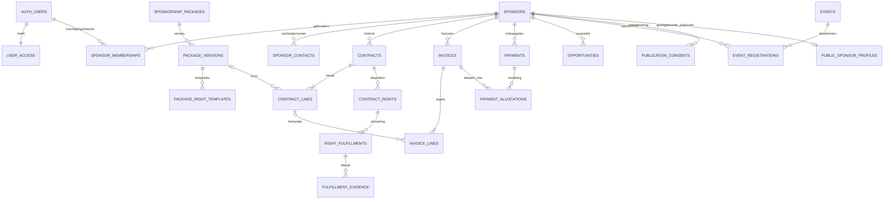

# VV Pernis Sponsorportaal

## 1. Status en gebruik van dit document

Dit is de functionele en technische projectbasis voor het nieuwe sponsorportaal van VV Pernis, een Nederlandse amateurvoetbalvereniging uit Rotterdam. Opdrachtgever is lid van de sponsorcommissie.

- Laatst bijgewerkt: 2026-11-12.
- Huidige fase: **2 — Design en navigatie**, geïmplementeerd en lokaal geverifieerd. De publieke basislayout en lokale interne/portaallayouts werken; functionele auth en productmodules volgen later.
- Volgende fase: **3 — Authenticatie en toegangsrechten**, uitsluitend na een nieuwe opdracht van de gebruiker.
- Alle onderstaande tabellen, routes, policies en processen zijn **ontwerp**, tenzij in `PROGRESS.md` expliciet als geïmplementeerd en geverifieerd vermeld.
- `PROJECT.md` beschrijft scope, architectuur, bedrijfsregels, ontwerpkeuzes en acceptatiecriteria. `PROGRESS.md` bevat de gedetailleerde voortgang, controles, open taken en bekende problemen. `AGENTS.md` bevat blijvende werkinstructies.
- Werk na iedere fase de faseaanduiding en belangrijke ontwerpbeslissingen hier bij; leg uitvoeringsdetails in `PROGRESS.md` vast. Ontwerp is geen bewijs van werkende functionaliteit.

### Vastgestelde werkmap en fase-1-basis

De geldige Git-checkout is `/workspace/VVPSponsor`, gekoppeld aan `ximmyyy/VVPSponsor`.
De inspectie van `/workspace` tijdens initialisatie beschreef de toen beschikbare
werkmap; het ontbreken van versiebeheer is in fase 1 opgelost door de bestaande
checkout vast te stellen en de drie nieuwe documentatiecommits via fast-forward op
te halen. Omgevingsmappen blijven ongemoeid.

Fase 1 levert Next.js/TypeScript, Tailwind-aansluiting, configuratievalidatie,
getypeerde browser-/SSR-leesclients, lokale Supabase-configuratie en één
basismigratie. Alleen `public.club_settings`, `public.user_profiles` en
`private.user_access` zijn geïmplementeerd. De vier rollen staan in
`private.app_role`; een minimale private policyhelper leest de actuele eigen rol.
Er is geen rolbeheer-, login-, sponsor-, financieel of Storage-proces. Nieuwe
installatie en startcommando's staan in `README.md`; exacte controles in `PROGRESS.md`.

Gepind: Node 24.22.1, npm 11.9.0, Next.js 16.4.6, React 19.3.1,
TypeScript 5.9.3, Tailwind 4.3.5, Supabase CLI 3.1.0, supabase-js 2.119.0,
SSR 0.12.7 en Zod 4.6.7. PostgreSQL draait lokaal op 17.11. De lockfile is
onderdeel van versiebeheer. ESLint 9.39.5 is de compatibele lijn voor de huidige
Next.js-plugins; de upstream supportwaarschuwing is een bekende toolingbeperking.

### Fase-2-ontwerp en grenzen

De opdrachtgever heeft clubblauw **`#125B9E`** en cluboranje **`#E67522`** aangeleverd.
De bronconfiguratie staat in `src/lib/branding.ts`; semantische CSS-/Tailwind-tokens
sturen alle layouts. Een typografisch VV-merk vervangt geen officieel logo; dat is
nog niet aangeleverd. Oranje wordt niet gebruikt voor kleine tekst op wit.

De publieke basislayout op `/` toont uitsluitend projectstatus en de toekomstige
indeling. Er zijn geen gepubliceerde sponsorprofielen, pakketten of aanvraagformulieren.
`/beheer`, `/beheer/bestuur`, `/portaal` en `/ontwerp` zijn **lokale ontwerpweergaven**,
geen roltoekenningen of ingelogde sessies. Ze zijn alleen bereikbaar met
`NODE_ENV=development`, `APP_ENV=local`, een loopback-host en zonder Vercel-context.
De ontwikkelserver bindt aan `127.0.0.1`. De server-side proxy blokkeert productie
met HTTP 404 en `no-store`, ook met `APP_ENV=local`; layouts herhalen de controle.
Er worden nergens bedrijfsgegevens geladen. Fase 3 moet echte sessie-/rolchecks
invoeren voordat deze routes als private applicatie ontsloten mogen worden.

De commissie-/bestuurs-/sponsorindelingen delen één shell met contextspecifieke
navigatie, mobiele Radix/shadcn Sheet, skiplink en zichtbare focus. Super Admin
krijgt later dezelfde interne shell met geautoriseerde beheeronderdelen; fase 2
heeft geen rolwisselaar of rolbeheer. Alleen het werkende overzicht heeft een link;
toekomstige modules zijn niet-interactief als 'Later' aangeduid. De lokale
componentenbibliotheek toont laad-, fout-, lege en tabelstatussen als voorbeelden.
De Next.js-fallbacks voor laden, fouten en niet-gevonden pagina's zijn aangesloten.

## 2. Doel en productgrenzen

Het platform professionaliseert sponsorrelaties, afspraken, commerciële activiteiten en financiële opvolging. Commissieleden beheren de administratie; sponsoren krijgen inzicht in hun eigen samenwerking met de club; geïnteresseerden zien uitsluitend goedgekeurde openbare informatie.

Er komen drie omgevingen binnen één modulair platform met één relationele gegevensbron:

### A. Interne sponsorcommissie

Een beveiligde beheeromgeving met:

1. Dashboard met sponsorstatistieken en aandachtspunten.
2. CRM met sponsorbedrijven en meerdere contactpersonen per bedrijf.
3. Beheer van sponsorpakketten en maatwerkafspraken.
4. Contracten, looptijden, opzegmomenten en verlengingen.
5. Financiële administratie met afzonderlijke contractwaarden, facturen en betalingen.
6. Afgesproken en uitgevoerde sponsorrechten, deadlines, verantwoordelijken en bewijsstukken.
7. Acquisitiepipeline voor potentiële sponsoren.
8. Taken en contactmomenten, met expliciet interne notities.
9. Sponsoractiviteiten en evenementen, inclusief deelnemersbeheer.
10. Documentbeheer met gecontroleerde toegang.
11. Notificaties en herinneringen.
12. Rapportages en exports met dezelfde autorisatie als de brongegevens.

### B. Persoonlijk sponsorportaal

Een beveiligde omgeving waarin gemachtigde gebruikers alleen gegevens van het eigen sponsorbedrijf zien:

1. Persoonlijk dashboard en eigen bedrijfsprofiel.
2. Huidig sponsorpakket en eigen contractgegevens, inclusief relevante historie.
3. Eigen sponsorrechten, voortgang en gedeeld bewijs van uitvoering.
4. Eigen documenten en facturen, voor zover voor de sponsor bestemd.
5. Aanmelden voor toegankelijke sponsorevenementen en eigen aanmelding beheren.
6. Contactverzoeken aan de commissie.
7. Wijzigingsverzoeken voor eigen bedrijfsgegevens; de commissie beoordeelt en verwerkt deze.
8. Meerdere gemachtigde gebruikers per sponsorbedrijf.

Interne CRM-notities, acquisitiegegevens, auditlogs, andere gebruikerslijsten en gegevens van andere sponsorbedrijven worden nooit via het sponsorportaal ontsloten. Een aangepast URL-, formulier- of API-ID geeft geen extra toegang.

### C. Publieke sponsoromgeving

Zonder login toegankelijk:

1. Overzicht van sponsoren met goedgekeurde bedrijfslogo's en openbare profielen.
2. Beschikbare sponsormogelijkheden op basis van door de club aangeleverde en goedgekeurde inhoud.
3. Aanvraagformulier voor potentiële sponsoren.
4. Goedgekeurde informatie over sponsoractiviteiten.
5. Contactmogelijkheden.

Publicatie is standaard uitgeschakeld. Alleen expliciet toegestane gegevens mogen openbaar worden. Publiceer geen privécontactpersonen, contractwaarden, documenten, facturen, deelnemerslijsten of interne notities. Een bedrijf dat in het CRM staat, is daarmee nog niet openbaar.

### Grenzen en expliciete uitsluitingen

- Geen officiële VV Pernis-pakketten, prijzen, sponsoren of contracten verzinnen. Tot echte gegevens worden aangeleverd uitsluitend herkenbare fictieve testgegevens, bijvoorbeeld `TEST — Sponsorbedrijf A`, met gereserveerde `.example`-adressen.
- Testgegevens uitsluitend in lokale/testomgevingen; geen automatische productieseeding of openbaar gemaakte voorbeeldsponsoren.
- Het financiële onderdeel is sponsoradministratie. Een volwaardig grootboek, bankkoppeling, betalingsprovider, fiscale aangifte, digitale ondertekening en koppeling met boekhoudsoftware vallen buiten de vastgestelde scope; afzonderlijk bespreken indien gewenst.
- Capacitor-geschiktheid is een architectuurdoel. Een iOS-app, native loginintegratie en App Store-publicatie zijn nog geen ontwikkelopdracht.
- Initialisatie omvat alleen de drie projectdocumenten. Geen scaffold, package-installatie, SQL-migratie, Supabase-project, productiedatabase of deployment in deze fase.

## 3. Rollen en autorisatie

Er zijn precies vier applicatierollen. Een publieke bezoeker is geen vijfde gebruikersrol; `anon` en `authenticated` zijn technische Supabase-rollen.

| Rol | Technische waarde | Beoogde rechten |
| --- | --- | --- |
| Super Admin | `super_admin` | Volledige applicatietoegang; gebruikers, rollen, bedrijfsmachtigingen en clubconfiguratie beheren. Gevoelige wijzigingen worden gelogd. |
| Sponsorcommissie | `sponsorcommissie` | Sponsors, contactpersonen, pakketten, contracten, rechten, financiën, acquisitie, taken, documenten en activiteiten beheren; geen eigen privilegeverhoging. |
| Clubbestuur | `clubbestuur` | Alleen lezen: rapportages, sponsoroverzichten en relevante financiële gegevens. Geen beheer of toegang tot alle interne notities op basis van deze rol. |
| Sponsor | `sponsor` | Alleen eigen bedrijfsgebonden portaalgegevens lezen; eigen verzoeken indienen en eigen evenementaanmelding beheren binnen vastgestelde regels. |

### Voorlopige rechtenmatrix

| Onderdeel | Super Admin | Sponsorcommissie | Clubbestuur | Sponsor |
| --- | --- | --- | --- | --- |
| Rollen, interne accounts, clubinstellingen | Beheer | Geen rolbeheer; branding lezen | Goedgekeurde branding lezen | Goedgekeurde branding lezen |
| Bedrijfsmachtigingen | Beheer | Sponsor uitnodigen/intrekken via beperkte workflow | Geen | Geen zelfmachtiging of uitnodigen |
| CRM-bedrijfsgegevens | Beheer | Beheer | Sponsoroverzicht lezen | Eigen portaalvelden lezen; wijzigingsverzoek |
| Contactpersonen en interne notities | Beheer | Beheer | Standaard geen | Alleen eigen gebruikersprofiel; geen interne CRM-lijst |
| Pakketten, contracten en rechten | Beheer | Beheer | Goedgekeurd overzicht lezen | Eigen bevestigde afspraken en gedeelde voortgang lezen |
| Facturen en betalingen | Beheer | Beheer | Relevante financiële informatie lezen | Eigen uitgereikte facturen en betaaloverzicht lezen |
| Documenten/bewijs | Beheer | Beheer | Alleen expliciet voor bestuur vrijgegeven | Alleen eigen expliciet gedeelde stukken |
| Pipeline, taken en contacthistorie | Beheer | Beheer | Alleen goedgekeurde rapportage | Geen |
| Evenementen | Beheer | Beheer | Goedgekeurd overzicht lezen | Toegankelijke evenementen en eigen aanmelding |
| Verzoeken/notificaties | Beheer | Behandelen | Alleen eigen notificaties | Eigen verzoeken en notificaties |
| Publicatie | Beheer | Beheer na vastgelegde toestemming | Alleen openbare inhoud lezen | Alleen openbare inhoud lezen |
| Auditlog | Lezen | Beperkte operationele historie | Geen | Geen |

De precieze bestuursexports en financiële kolommen worden vóór ontsluiting afgestemd. Tot die tijd geldt de kleinste hierboven beschreven toegang. Schrijfbevoegdheid op financiën impliceert geen bevoegdheid om uitgereikte facturen of bevestigde historie te overschrijven.

### Afdwingen in applicatie en database

- Verifieer identiteit server-side met de op dat moment aanbevolen Supabase Auth-methode; vertrouw niet op ongeverifieerde sessiegegevens of alleen een navigatieguard.
- Controleer rol en actieve bedrijfsmachtiging bij elke servermutatie, download, export en relevante query. Een door de client meegestuurd `sponsor_id` is nooit bewijs van toegang.
- Gebruik als autorisatiebron afgeschermde databaserecords voor rol, accountstatus en machtiging. Geen autorisatie op basis van door gebruikers wijzigbare `user_metadata`. JWT-claims zijn hooguit aanvullend en kunnen verouderd zijn.
- Voorlopig één actieve applicatierol per gebruiker en één actieve bedrijfskoppeling per sponsoraccount. Een bedrijf heeft meerdere gebruikers. De wens voor één persoon die meerdere bedrijven vertegenwoordigt is een open vraag; niet stilzwijgend implementeren.
- RLS op alle tabellen in blootgestelde schema's, met expliciete SQL-grants. Geen policies betekent geen toegang. Sponsorbeleid vereist zowel een actief account met rol `sponsor` als een actieve machtiging voor de betreffende rij.
- Gebruik per operatie eigen policies; bij updates zowel `USING` als `WITH CHECK`. Beveilig ook inserts en wijzigingen van `sponsor_id`, gebruikerskoppelingen en bovenliggende verwijzingen.
- RLS beperkt rijen, geen afzonderlijke kolommen. Plaats interne notities en beheerdata apart; beperk kolomrechten en gebruik expliciete selecties/DTO's en veilige projecties voor bestuur en sponsoren. Alleen velden uit een UI weglaten is onvoldoende.
- Gewone databaseviews gebruiken `security_invoker = true`; vertrouw niet op standaardviewrechten. Geen onbeschermde aggregaties of materialized views naar de client.
- Voorkom recursieve policies op rollen/machtigingen. Alleen indien nodig een kleine beoordeelde helper in een niet-blootgesteld schema met vaste `search_path`, expliciete controle van `auth.uid()` en minimale uitvoerrechten voor de vereiste policy-aanroepers. Geen algemeen schrijfbare `SECURITY DEFINER`-API.
- Reguliere gebruikersverzoeken gebruiken een Supabase-client met de eigen gebruikerssessie, zodat RLS blijft gelden. Een secret/service-role-client omzeilt RLS en is uitsluitend server-side voor strikt begrensde beheer- of achtergrondtaken met aparte autorisatie en audit.
- Alleen Super Admin beheert interne rollen. De commissie kan uitsluitend de beperkte sponsoruitnodigingsworkflow gebruiken; deze mag alleen een sponsorrol en de bedoelde bedrijfsmachtiging opleveren. Uitnodigingen verlopen en zijn eenmalig; ken niet op basis van een e-maildomein automatisch toegang toe.
- Sponsoraccounts zijn voorlopig invitation-only. Een account zonder expliciet geactiveerde rol/machtiging krijgt geen privérechten; een publieke sponsoraanvraag is geen accountaanmaak of bedrijfsmachtiging.
- Intrekken van een bedrijfsmachtiging blokkeert de volgende databasetoegang ook met een nog geldig JWT. Reeds uitgegeven signed URLs blijven tot hun vervaltijd bruikbaar; gebruik korte geldigheid. Volledige accountblokkade omvat ook sessiebeheer. Onderzoek MFA voor interne gebruikers in fase 3.

## 4. Technische architectuur

### Stack

| Onderdeel | Keuze en toepassing |
| --- | --- |
| Webapplicatie | Next.js met TypeScript en App Router; ondersteunde stabiele versies kiezen en vastleggen in fase 1 |
| UI | Tailwind CSS, shadcn/ui, Lucide Icons |
| Formulieren | React Hook Form voor interactieve formulieren; Zod voor gedeelde schema's en servervalidatie |
| Data | Supabase PostgreSQL; relationele constraints, transacties en RLS |
| Identiteit | Supabase Auth en `@supabase/ssr` voor websessies |
| Bestanden | Supabase Storage met gescheiden private documenten en goedgekeurde publieke assets |
| Grafieken | Recharts op geautoriseerde aggregaties |
| Hosting | Vercel; pas configureren/publiceren in een daarvoor opgedragen fase |
| Toekomst | Capacitor, met apart te toetsen native sessies, deep links en distributie |

### Modulegrenzen en toekomstige mappen

Onderstaande structuur blijft het doelontwerp. De fundering en fase-2-layouts zijn aangemaakt; functionele modules volgen in hun eigen fase:

```text
src/
  app/
    (public)/                 # /sponsoren, /sponsormogelijkheden, /contact
    (auth)/                   # /inloggen, herstel, uitnodiging
    beheer/                   # interne omgeving; rolcontrole server-side
    portaal/                  # eigen sponsoromgeving
    api/                      # noodzakelijke HTTP-ingangen, toekomstige native adapter
  modules/
    auth/ sponsors/ packages/ contracts/ finance/
    rights/ documents/ acquisition/ tasks/ events/
    notifications/ reporting/ public-site/ settings/
  components/ui/              # shadcn/ui en gedeelde toegankelijke componenten
  lib/
    supabase/                 # gescheiden browser-, SSR- en beperkte adminclient
    authz/                    # serverautorisatie en context
    env/                      # Zod-validatie van publieke/serverconfiguratie
    shared/                   # datum-, geld- en andere gedeelde primitives
supabase/
  migrations/                 # geversioneerde schema-, grant-, RLS- en Storage-wijzigingen
  tests/                      # database-/RLS-integratietests
  seed.sql                    # alleen fictieve lokale/testdata, indien opgedragen
tests/                        # passende integratie- en end-to-endtests
```

Elke module bevat eigen validatie, domeinlogica, datatoegang en UI. Routes en Server Actions blijven dunne adapters. Modules communiceren via expliciete services en getypeerde gegevens; geen tweede CRM of eigen factuurtotalen per omgeving. Zod-validatie wordt server-side herhaald; databaseconstraints blijven de laatste integriteitscontrole.

Server Components zijn de standaard voor geautoriseerde leesacties; Client Components voor interactie en grafieken. Server Actions/Route Handlers controleren steeds de gebruiker en de gevraagde operatie. Meerstapswijzigingen zoals contractvastlegging en betalingstoewijzing verlopen atomair via gecontroleerde databasetransacties/RPC's; losse API-aanroepen vormen samen geen transactie.

De businesslogica hangt niet van webpagina's af. Voor een toekomstige Capacitor-app kunnen geautoriseerde HTTP-adapters dezelfde services gebruiken. SSR is niet rechtstreeks een statische native bundel; de keuze tussen een gehoste webapp en een afzonderlijke native client wordt later beproefd. Geen belofte dat de Next.js-app zonder aanpassing native werkt.

### Design, navigatie en toegankelijkheid

- Professioneel, sportief zakelijk SaaS-ontwerp: primair blauw, secundair oranje, gecombineerd met wit, lichtgrijs en donkerblauw.
- Kleuren via semantische CSS-variabelen/Tailwind-tokens en `src/lib/branding.ts`: de opdrachtgever leverde blauw `#125B9E` en oranje `#E67522`. Clubnaam en kleuren zijn configureerbaar; een database-adapter voor branding volgt later. Officieel logo nog niet aangeleverd.
- Interne navigatie: Dashboard, Sponsors, Pakketten, Contracten, Sponsorrechten, Financiën, Acquisitie, Taken, Evenementen, Documenten, Rapportages en rolgebonden Instellingen. Alleen beschikbare modules activeren.
- Sponsornavigatie: Overzicht, Bedrijf, Samenwerking, Sponsorrechten, Documenten en facturen, Evenementen, Contact. Bestuur krijgt eigen leesnavigatie binnen de interne omgeving.
- Mobile-first, bruikbaar vanaf circa 360 px; grote aanraakdoelen, responsieve kaarten/tabellen en mobiele navigatie. WCAG 2.2 AA als ontwerpdoel: contrast, toetsenbordbediening, zichtbare focus, formulierlabels en foutmeldingen. Status nooit alleen met kleur communiceren.
- Expliciete laad-, lege-, fout- en successtatussen. Geen knoppen die succes suggereren zonder opgeslagen resultaat; geen statische demo presenteren als werkende backend.
- Nederlandse interface, `nl-NL`-notatie en EUR als voorlopige standaard. Datums in `Europe/Amsterdam`; technische timestamps in UTC.

### Bestanden en publicatie

- Contracten, facturen en bewijsstukken standaard in private buckets. Metadata in `documents`; autorisatie geldt óók rechtstreeks op `storage.objects`.
- Bestandsnamen/paden bevatten onvoorspelbare IDs; het pad alleen verleent geen recht. Controleer bedrijf, documentstatus, zichtbaarheid en relaties bij iedere operatie.
- Downloads via gebruikers-JWT of kort geldige signed URL na autorisatie. Geen signed URLs in logs, notificatieteksten of permanente databasevelden opslaan.
- Uploadlimieten en MIME-/inhoudsvalidatie; geen ongetoetste HTML/SVG of uitvoerbare inhoud serveren. Niet stilzwijgend bestanden vervangen; gebruik documentversies. Een pending upload wordt pas na controle downloadbaar; houd rekening met opruimen van mislukte uploads.
- Gedeelde documenten blijven privé; alleen vooraf goedgekeurde publieke logo's/media mogen naar een aparte public bucket. Een public bucket omzeilt downloadautorisatie voor iedereen met de URL.
- Publicatie is een gecontroleerde workflow met toegestane velden, vastgelegde toestemming, goedkeurder, geldigheid en intrekking. Intrekking verwijdert publicatie, publieke assets en relevante caches; openbare kopieën bij derden zijn niet volledig terug te halen.
- Private reacties niet in gedeelde caches opslaan. Publieke caching alleen op gepubliceerde projecties met een expliciete verversings-/intrekkingsstrategie.

## 5. Voorlopig relationeel datamodel

### Conventies en integriteitsregels

- Eén clubinstallatie voor VV Pernis; geen generiek multiclub-SaaS in de eerste scope. `sponsor_id` vormt de bedrijfsgrens voor sponsorgegevens.
- Tabellen en kolommen in Engels `snake_case`; zakelijke teksten en interface in het Nederlands. UUID als primaire sleutel, behalve zinvolle samengestelde koppelsleutels. Domeintabellen hebben waar toepasselijk `created_at`, `updated_at` en actorverwijzingen. Deze technische velden staan niet in iedere tabelregel hieronder.
- `auth.users` blijft door Supabase beheerd. Een contactpersoon is niet automatisch een loginaccount; koppeling gebeurt uitsluitend na uitnodiging/verificatie.
- Geldbedragen exact als `numeric`, voorlopig `numeric(14,2)` voor totalen en hogere precisie voor eenheidsprijzen/percentages. Geen floats voor geld. ISO-valutacode, voorlopig EUR. BTW, afronding en financiële definities vaststellen vóór fase 6.
- Zakelijke looptijden/deadlines als `date`; gebeurtenissen als `timestamptz`. Controleer einddatum ≥ begindatum en vereiste bedragen/hoeveelheden.
- Kindtabellen met `sponsor_id` krijgen waar mogelijk samengestelde foreign keys naar `(id, sponsor_id)` van hun ouder. De beperkte herhaling van de bedrijfssleutel is bedoeld voor isolatie en wordt door constraints afgedwongen; niet vrij wijzigbaar.
- Indexeer foreign keys en filter-/RLS-kolommen, met name machtigingen `(user_id, sponsor_id)`, contracten `(sponsor_id, status, ends_on)` en facturen `(sponsor_id, due_on)`. Vermijd indexen zonder querydoel; toets met echte queryplannen zodra data en queries bestaan.
- Alleen beperkte JSONB voor bijvoorbeeld adresmomentopnamen, auditdetails en gevalideerde wijzigingsverzoeken; kernrelaties, rechten en geldstromen blijven relationeel.
- Historische contracten en uitgereikte facturen niet overschrijven bij stamgegevenswijzigingen. Momentopnamen zijn bewuste historische vastlegging, geen tweede bron voor actuele stamgegevens.
- Standaard archiveren in plaats van verwijderen. Restrictieve delete-FK's op historie en financiën; geen cascade vanaf een bedrijf of auth-account die contracten/facturen wist. Bewaartermijnen en eventuele anonimisering later vaststellen. Geen destructieve databaseoperatie zonder toestemming.

### Identiteit, club en CRM

| Tabel | Belangrijkste velden/relaties | Regels/doel |
| --- | --- | --- |
| `club_settings` | singleton, clubnaam, branding, goedgekeurd logo, locale, timezone | Alleen niet-geheime clubconfiguratie; beheer door Super Admin. Publiek uitsluitend veilige brandingvelden. |
| `user_profiles` | `user_id` → `auth.users`, weergavenaam, voorkeuren | Eigen profielgegevens; rol en bedrijf niet door gebruiker wijzigbaar. |
| `private.user_access` | `user_id` → `auth.users`, `role`, `is_active` | Afgeschermde autorisatiebron met één van vier rollen; geen publieke gebruikerslijst. |
| `sponsors` | naam, handelsnaam, KvK/BTW indien nodig, zakelijke adressen, website, relatiestatus, `archived_at` | Eén bedrijfsrecord voor prospect én sponsor; geen dubbel bedrijf na conversie. Statussen ontwerpen in fase 4. Geen interne notities in sponsorleesbare velden. |
| `sponsor_internal` | `sponsor_id` → `sponsors`, commissie-eigenaar, interne notities | Afgeschermde interne bedrijfsinformatie. |
| `sponsor_contacts` | `sponsor_id`, naam, functie, zakelijke e-mail/telefoon, primair-contactindicatie | Bedrijf 1:N contactpersonen; maximaal één primair contact via constraint. Geen verplichte login. |
| `sponsor_memberships` | `sponsor_id`, `user_id`, status, geactiveerd/ingetrokken op | Bedrijf 1:N gemachtigde gebruikers. Voorlopig maximaal één actieve bedrijfskoppeling per sponsoraccount; consistent met `user_access`. |
| `sponsor_invitations` | `sponsor_id`, e-mail, eventuele contactverwijzing, tokenhash/providerreferentie, vervaltijd, gebruikt/ingetrokken op | Geen plaintext uitnodigingstokens opslaan. Activatie koppelt geverifieerde identiteit en bedrijf atomair; contactrelatie binnen hetzelfde bedrijf. |

### Pakketten, contracten en sponsorrechten

| Tabel | Belangrijkste velden/relaties | Regels/doel |
| --- | --- | --- |
| `sponsorship_packages` | naam, omschrijving, actief/gearchiveerd | Pakketidentiteit, geen officiële inhoud totdat aangeleverd. |
| `package_versions` | `package_id`, versienummer, omschrijving, richtprijs, valuta, status | Uniek `(package_id, version_number)`; gepubliceerde versies onveranderlijk. Nieuwe versie bij wijziging. |
| `package_right_templates` | `package_version_id`, omschrijving, hoeveelheid, eenheid, planning | Rechten van precies één pakketversie; geen directe contractuitvoering op templates. |
| `contracts` | `sponsor_id`, contractnummer, status, begin/einde, opzeg-/verlenggegevens, `predecessor_contract_id`, partij- en voorwaardenmomentopname | Bedrijf 1:N contracten, ook opeenvolgende seizoenen. Contractnummer uniek; voorganger hoort bij hetzelfde bedrijf. Een verlenging levert een nieuw contract; geen stilzwijgende automatische verlenging. |
| `contract_lines` | `contract_id`, `sponsor_id`, optioneel `package_version_id`, titel-/prijsmomentopname, hoeveelheid, eenheidsprijs, BTW, valuta | Contract 1:N regels; ook maatwerk zonder pakket. Meerdere regels kunnen verschillende pakketten/afspraken vastleggen. |
| `contract_rights` | `contract_id`, optioneel `contract_line_id`/brontemplate, `sponsor_id`, afgesproken omschrijving/hoeveelheid, deadline, verantwoordelijke, status, portaalzichtbaarheid | Contract 1:N eigen rechtmomentopnamen; pakketwijziging verandert ze niet. Verantwoordelijke is bevoegd intern account. |
| `right_fulfillments` | `contract_right_id`, `sponsor_id`, uitvoerdatum, hoeveelheid, omschrijving, geregistreerd/gecontroleerd door | Recht 1:N uitvoeringsregistraties; ondersteunt gedeeltelijke uitvoering. Interne werknotities apart van gedeelde bewijsomschrijving. |
| `contract_amendments` | `contract_id`, `sponsor_id`, volgnummer, datum, reden, vastgelegde wijziging, optioneel document | Formele wijzigingshistorie. Definitieve afspraken niet onzichtbaar herschrijven; exacte amendementwerking in fase 5 uitwerken en testen. |

Bij bevestigen van een contract worden regels en rechten uit de gekozen versie **gekopieerd als eigen afspraken**, inclusief maatwerk. Ontwerpstatussen zijn voorlopig `draft`, `confirmed`, `terminated`, `expired`; bevestiging betekent nog geen geïmplementeerde digitale handtekening. Bevestigde baselines zijn onveranderlijk. Verlenging en materiële wijzigingen vereisen een nieuwe vastlegging of gecontroleerd amendement met behoud van de vorige toestand. Lopende contracten kunnen naast elkaar bestaan; een portaal mag niet willekeurig één record als enige samenwerking kiezen.

### Financieel beheer en documenten

| Tabel | Belangrijkste velden/relaties | Regels/doel |
| --- | --- | --- |
| `invoices` | `sponsor_id`, factuurnummer, type factuur/credit, status, factuur-/vervaldatum, valuta, factuuradresmomentopname, eventuele `original_invoice_id` | Bedrijf 1:N facturen. Nummer uniek bij uitreiken; concept heeft nog geen definitief nummer nodig. Credit verwijst naar oorspronkelijke factuur van hetzelfde bedrijf. |
| `invoice_lines` | `invoice_id`, `sponsor_id`, optioneel `contract_line_id`, omschrijving-/prijsmomentopname, hoeveelheid, BTW | Factuur 1:N regels; contractkoppeling binnen hetzelfde bedrijf. Een contract kan in termijnen over meerdere facturen worden gefactureerd. |
| `payments` | `sponsor_id`, datum, bedrag, valuta, methode, referentie, status, eventuele correctie-/terugbetalingsverwijzing | Ontvangen geld apart van facturen; handmatige registratie eerst, geen veronderstelde bankkoppeling. Niet-toegewezen bedragen blijven zichtbaar. |
| `payment_allocations` | `payment_id`, `invoice_id`, `sponsor_id`, toegewezen bedrag | N:M tussen betalingen en facturen; meerdere deelbetalingen of één betaling voor meerdere facturen. Atomair voorkomen dat meer dan beschikbaar wordt toegewezen. |
| `credit_allocations` | creditfactuur, oorspronkelijke/doelfactuur, `sponsor_id`, bedrag | Creditverrekening apart van ontvangen betalingen. Bedragen, valuta en bedrijf moeten overeenkomen; restitutie apart registreren. |
| `documents` | optioneel `sponsor_id`, categorie, zichtbaarheid, uploadstatus, titel, `bucket_id`, objectpad, MIME, grootte, checksum, versie/vervangen document | Uniek bucket/objectpad. `sponsor_shared` vereist bedrijf; interne clubdocumenten zonder bedrijf nooit sponsortoegang. Privébestanden niet via een `public`-vlag openbaar maken. |
| `contract_documents` | `contract_id`, `document_id`, `sponsor_id`, documentrol | Getypeerde koppeling met FK's voor bedrijf en contract. |
| `invoice_documents` | `invoice_id`, `document_id`, `sponsor_id` | Factuur-PDF aan de juiste factuur en het juiste bedrijf. |
| `fulfillment_evidence` | `right_fulfillment_id`, `document_id`, `sponsor_id` | Uitvoering 1:N bewijsstukken; expliciete portaalvrijgave blijft noodzakelijk. |

Rapportages maken contractwaarde, gefactureerd bedrag, credits, ontvangen geld en openstaand saldo apart zichtbaar. Contractwaarde volgt uit vastgelegde contractregels en geldige amendementen; factuurtotalen uit factuurregels. Openstaand saldo volgt uit uitgereikte facturen, toegewezen betalingen en credits. Ontvangsten worden op betaaldatum gemeten; deelbetalingen en nog niet toegewezen betalingen tellen niet tweemaal. Afgeleide bedragen/statussen centraal berekenen; eventuele opgeslagen financiële totalen alleen als gecontroleerde, reconcilieerbare momentopname. Concurrente toewijzingen vereisen transacties en vergrendeling. Uitgereikte facturen corrigeren via credits, geen stilzwijgende regelmutaties. Definities van inclusief/exclusief BTW, seizoen en rapportageperiode vaststellen vóór implementatie.

### Acquisitie, werkstromen en publieke inhoud

| Tabel | Belangrijkste velden/relaties | Regels/doel |
| --- | --- | --- |
| `pipeline_stages` | naam, volgorde, categorie open/gewonnen/verloren | Configureerbare fasen; niet dubbel als bedrijfstatusadministratie gebruiken. |
| `opportunities` | `sponsor_id`, `stage_id`, eigenaar, verwachte waarde, kans, verwachte sluitdatum, afsluitreden | Bedrijf 1:N commerciële kansen; gewonnen kans is niet automatisch ontvangen omzet. |
| `contact_interactions` | `sponsor_id`, optioneel contact/kans, intern account, datum, kanaal, interne samenvatting, vervolgdatum | Interne contacthistorie, nooit standaard zichtbaar voor sponsor. |
| `tasks` | optioneel `sponsor_id`, contract/recht/kans, eigenaar, titel, deadline, status | Interne taken; optionele relaties via echte FK's en consistente bedrijfsgrens. |
| `events` | titel, omschrijving, begin/einde, locatie, capaciteit, inschrijfvenster, doelgroep/status | Beheerde sponsoractiviteiten; aparte openbare publicatie van goedgekeurde velden. |
| `event_invitations` | `event_id`, `sponsor_id` | Uniek evenement/bedrijf voor gerichte toegang; algemeen toegankelijke sponsorevenementen hebben expliciete doelgroep. |
| `event_registrations` | `event_id`, `sponsor_id`, aanmelder, aantal personen, status | Voorlopig één bedrijfsaanmelding per evenement, door meerdere gemachtigden te beheren; keuze later bevestigen. Geen zicht op andere bedrijven/deelnemers. Capaciteitscontrole atomair. |
| `sponsor_requests` | `sponsor_id`, indiener, type contact/profielwijziging, toegestane voorgestelde velden, status, behandelaar, antwoord | Sponsor kan geen rollen, bedrijfskoppeling, contractwaarde of toestemming via payload wijzigen. Beoordeling en stamgegevenswijziging samen loggen. |
| `notifications` | ontvanger, optioneel bedrijf en gerelateerde bron, type, tekst, gelezen op | Alleen eigen meldingen; links geven geen nieuwe toegang. Geen gevoelige bijlagen of volledige factuurinhoud in melding/e-mail. |
| `notification_jobs` | bron/type, ontvanger, gepland op, status, deduplicatiesleutel, pogingen, verzonden op | Afgeschermde outbox voor idempotente herinneringen en toekomstige e-mailaflevering. Dubbele uitvoering voorkomen. |
| `publication_consents` | `sponsor_id`, scope van velden/assets, grondslag/toestemming, herkomst/bewijs, geldig vanaf/tot, ingetrokken op, vastlegger | Private toestemmingshistorie. Alleen geldige, voldoende specifieke publicatietoestemming geeft vrijgave. |
| `public_sponsor_profiles` | `sponsor_id`, unieke slug, goedgekeurde openbare naam/tekst/website/logo, publicatiestatus/geldigheid, goedkeurder, toestemmingsreferentie | Afzonderlijke publicatieprojectie zonder interne velden; gecontroleerde vastgelegde inhoud, geen tweede CRM. Niet automatisch iedere CRM-wijziging publiceren. |
| `public_opportunities` | optionele pakketversie, titel, goedgekeurde tekst, aanvraagmogelijkheid, publicatiestatus | Alleen aangeleverde sponsormogelijkheden/prijzen; geen automatische contractinhoud publiceren. |
| `public_event_pages` | `event_id`, slug, goedgekeurde openbare tekst, publicatiestatus | Openbare activiteiteninformatie zonder privédeelnemers of interne eventdata. |
| `sponsor_applications` | aangeleverde bedrijfs-/contactvelden, bericht, privacyverklaringversie, tijdstip, behandelstatus, optioneel gekoppeld `sponsor_id` | Publieke aanvragen apart van CRM; eerst beoordelen/dedupliceren. Geen publieke lijst of directe wijzigingsrechten. |
| `audit_log` | actor, actie, entiteit, tijdstip, beperkte wijzigingsdetails, correlatie-ID | Append-only voor applicatiegebruikers; gevoelige mutaties vanuit vertrouwde laag vastleggen. Geen wachtwoorden, tokens of documentinhoud loggen. |

Publieke projecties bevatten uitsluitend goedgekeurde velden; toestemming/intrekking en publicatiestatus worden in één gecontroleerde workflow verwerkt. Policies toetsen ook publicatiegeldigheid op het moment van lezen; verlopen toestemming mag niet op een nachtelijke opruimtaak wachten. Bij toekomstige koppeling van een echte aanvraag aan het CRM eerst mogelijke dubbelen beoordelen. Private toestemmingsbewijzen en aanvraaggegevens blijven afgeschermd.

### Relatieoverzicht



Het diagram toont kernrelaties, niet alle tabellen/constraints. Minima zoals ten minste één contract- of factuurregel gelden bij bevestigen/uitreiken; een concept kan nog leeg zijn. De unieke actieve bedrijfsmachtiging is een voorlopige ontwerpkeuze. De tabellen worden **per module** uitgewerkt en via migraties toegevoegd, niet allemaal tegelijk in fase 1.

## 6. Implementatieplan, afhankelijkheden en acceptatiecriteria

Iedere fase start met een nieuwe gebruikersopdracht en eindigt met relevante controles, opgeloste fouten, bijgewerkte documentatie en een eerlijk verslag van werkende onderdelen en resterende configuratie. Volgende fases zijn een routekaart, geen uitvoeringsmachtiging. Bestaande functionaliteit behouden. Bij fasewijzigingen eerst afhankelijkheden controleren.

| Fase/module | Afhankelijk van | Beoogde implementatie en acceptatie |
| --- | --- | --- |
| **0. Initialisatie** | Geen | Repository inspecteren; drie consistente projectdocumenten met architectuur, datamodel, plan, risico's en configuratieoverzicht. Geen app, database of deployment. |
| **1. Projectarchitectuur en database** | 0 | Versies/packagebeheer vastleggen; Next.js/TypeScript-basis en modulegrenzen; configuratievalidatie; lokale Supabase-inrichting, migratie- en testworkflow en minimale club-/identiteits-/autorisatiebasis. Acceptatie: installatie, lint/typecheck/build volgens gekozen tooling; lokale basismigraties reproduceerbaar; geen onbeschermde blootgestelde tabellen; lokaal basis-RLS getest. Nog geen volledige domeintabellen of functionele modules. |
| **2. Design en navigatie** | 1 | Responsieve interne/publieke/portaalshells, configureerbare brandingtokens, toegankelijke componenten en fout-/legestatussen. Acceptatie: bruikbaar op mobiel en desktop, toetsenbordcontrole, geen links/knoppen die onbestaande functionaliteit als werkend presenteren. Zonder functionele auth blijft interne shell lokaal/niet publiek beschikbaar. |
| **3. Authenticatie en toegangsrechten** | 1–2 | Login/logout, herstel/uitnodiging, SSR-sessie, vier rollen, accountstatus, actieve bedrijfsmachtiging en private Storage-basis. Sponsorisolatietests met minimale fictieve bedrijven; geen volledig CRM. Acceptatie: rolgrenzen via server én directe Data/Storage API getest, sponsor A heeft geen toegang tot B, rolwijziging/zelfmachtiging geblokkeerd, intrekking getest. Geen afscherming uitsluitend in UI. |
| **4. Sponsor CRM** | 1–3 | Bedrijven, contactpersonen, interne informatie, zoeken/filteren, archiveren en beperkte uitnodigingen. Acceptatie: meerdere contacten en gebruikers, gecontroleerde invoer, veilige sponsorleesvelden en interne notities afgescheiden; geen dubbel bedrijf bij prospectconversie. |
| **5. Sponsorpakketten en contracten** | 3–4 | Pakketversies, maatwerk, contractregels, historie/verlenging/amendementen, sponsorrechten, deadlines, uitvoering en private bewijs-/contractdocumenten. Acceptatie: pakketwijziging laat oud contract intact; één bedrijf met meerdere contracten en rechten; bevestiging atomair, historische afspraken reconstrueerbaar en documenten afgeschermd. |
| **6. Financieel beheer** | 3–5 | Facturen en regels, uitreiken/nummering, credits, afzonderlijke betalingen en toewijzingen, private factuurdocumenten. Acceptatie: contractwaarde ≠ facturatie ≠ ontvangst; termijnen, deelbetaling, krediet, onverdeelde betaling en concurrente toewijzing correct; correcties traceerbaar. Nog geen niet-afgesproken bank-/boekhoudkoppeling. |
| **7. Intern dashboard en rapportages** | 4–6 | Eenduidige sponsor-/contract-/rechten-/financiële indicatoren, Recharts, bestuurstoegang en exports. Acceptatie: waarden sluiten aan op bronregistratie en gekozen periode/BTW-definities; bestuur alleen toegestane velden; exports hebben dezelfde scope en beschermen tegen spreadsheetformules. |
| **8. Persoonlijk sponsorportaal** | 3–7 | Eigen dashboard, profiel, samenwerking/historie, rechten/bewijs, documenten/facturen en contact-/profielwijzigingsverzoeken. Acceptatie: uitsluitend eigen vrijgegeven data met meerdere gemachtigde gebruikers; verzoekbeoordeling werkt; mobiele volledige gebruikersflow getest. Evenementen pas activeren zodra fase 9 werkt. |
| **9. Acquisitie, evenementen en notificaties** | 4–8 | Pipeline, contactmomenten, taken, evenementen, uitnodigingen/aanmeldingen, herinneringen en outbox. Acceptatie: kansen hergebruiken CRM-bedrijf; capaciteitscontrole en doelgroeprechten kloppen; sponsor ziet alleen eigen registratie; herinneringen zijn idempotent en herhaalbaar bij fouten. Mail pas als provider werkelijk geconfigureerd is. |
| **10. Publieke sponsorwebsite en productievoorbereiding** | 2–9 | Goedgekeurde sponsorprofielen, sponsormogelijkheden, activiteiten, aanvraag/contact, publicatiebeheer; security-/privacy-/restorecontroles en Vercel-productievoorbereiding. Acceptatie: standaard niets ongeoorloofd openbaar, intrekking getest inclusief assets/cache, aanvragen alleen afgeschermd verwerkt, productieconfiguratie en beheerhandleiding gereed. Aanmaken productiedatabase en daadwerkelijke deployment uitsluitend wanneer expliciet opgedragen. |

### Afhankelijkheden en gedeeld eigenaarschap

- **1 levert aan alle modules:** schema-/migratieconventies, config, typed datatoegang en testbasis.
- **2 levert aan alle schermen:** design tokens, layouts, componenten en navigatie; verleent zelf geen rechten.
- **3 levert aan alle private modules:** identiteit, rolchecks, bedrijfsmachtiging, RLS- en Storage-patroon. Geen private module extern beschikbaar vóór dit werkt.
- **4 is bron van bedrijven/contacten:** contracten, facturen, kansen, evenementen en aanvragen verwijzen naar hetzelfde bedrijfsrecord.
- **5 is bron van afspraken:** 6 factureert de contractregels; 7 en 8 lezen dezelfde vastgelegde contracten/rechten.
- **6 is bron van facturatie/ontvangsten:** 7 en 8 berekenen geen eigen afwijkende financiële waarheid.
- **7 consumeert 4–6:** rapportages muteren de bronadministratie niet; 9 voegt later aanvullende indicatoren toe.
- **8 hergebruikt 3–7:** eigen verzoeken zijn een workflow; geen rechtstreekse ongecontroleerde wijziging van stamgegevens.
- **9 consumeert CRM, contractdeadlines en vervaldata uit 4–6:** outbox is gedeelde afleverinfrastructuur. Evenementschermen in het portaal volgen in deze fase.
- **10 consumeert uitsluitend goedgekeurde publicatieprojecties:** privé-CRM nooit gebruiken als rechtstreeks publiek endpoint.
- Documentmetadata en auditbasis worden stapsgewijs ingevoerd vanaf de eerste muterende module; documentenbeheer groeit bij 5 en 6. Notificaties uit eerdere fases worden pas automatisch verzonden nadat 9 is geïmplementeerd.

## 7. Migraties, kwaliteit en verificatie

- Alle schema-, constraint-, grant-, RLS-, functie- en Storage-policywijzigingen zijn reviewbare migraties. Geen handmatige wijzigingen in een gedeelde database als verborgen bron van waarheid.
- Ontwikkel lokaal/geïsoleerd, controleer eerst het doel en de bestaande schema's. Gebruik bij implementatie actuele Supabase-documentatie, CLI-versie en `--help`; genereer migraties met de ondersteunde CLI-workflow. Verzin geen migratienamen/CLI-argumenten op basis van geheugen.
- De Supabase-changelog meldt een CLI v3-wijziging in doelkeuze/hosted bevestigingen. Selecteer en pin de CLI-versie in fase 1; leg lokale versus remote uitvoering expliciet vast. Voer niet stilzwijgend een remote push/reset uit.
- Nieuwe migraties moeten op een lege lokale testdatabase én op de vorige ondersteunde lokale schemastand werken. Een lokale reset alleen op een aantoonbaar wegwerpbare testomgeving, nooit op een gedeelde/productiedatabase.
- Destructieve databaseoperaties vereisen toestemming; bereid eerst een concreet plan, risico's en herstelpad voor. Ook bij geautoriseerde ontwikkelfases geen destructieve werking verstoppen in een migratie.
- TypeScript strict, versies en lockfile vastleggen, geheimen buiten Git. Gegenereerde databasetypes bijwerken na schemawijzigingen.
- Voer aanwezige, relevante controles uit. Zodra beschikbaar: lint, typecheck, build; gerichte domeintests bij financiële/historische logica; database-/RLS-integratietests en kritieke end-to-endflows. Geen overbodige tests die alleen implementatiedetails kopiëren.
- De autorisatietestmatrix omvat alle vier rollen plus niet-ingelogd, twee sponsorbedrijven met meerdere gebruikers, ingetrokken accounts/machtigingen en directe API-toegang. Test lezen, invoegen, wijzigen, verwijderen, relink naar ander bedrijf, downloads, exports en aggregaties. RLS niet uitsluitend als database-eigenaar/service role testen.
- Historietests: pakketversiewijziging, verlenging, maatwerk, amendement, meerdere gelijktijdige contracten. Financiële tests: afronding, termijnfacturen, credits/restituties, deelbetalingen, dubbele registratie en concurrente toewijzing.
- Inspecteer Supabase security/performance advisors bij echte schema- en policywijzigingen; los relevante bevindingen op. Geen dergelijke controle als uitgevoerd rapporteren zolang geen database bestaat.
- Elke fase eindigt met exacte uitgevoerde controles en resterende beperkingen in `PROGRESS.md`. Een ontbrekend testscript of credential is een beperking, geen geslaagde test.

## 8. Benodigde configuratie en environment variables

**Fase 1 gebruikt alleen lokale configuratie.** `.env.example` bevat placeholders;
`npm run env:local` maakt veilig een genegeerde `.env.local` met `APP_ENV`, app-URL,
lokale Supabase-URL en publishable key. Bestaande bestanden worden niet overschreven.
Geen secret/service-role-key, hosted project of productiegegevens zijn vereist.
De startpagina werkt zonder databaseconfiguratie; Supabase-clients valideren de
configuratie bij aanroep. Overige onderstaande namen blijven toekomstig ontwerp.
Werkelijke geheime waarden uitsluitend via veilig omgevingsbeheer; nooit in chat,
documentatie, broncode of logs.

| Naam | Bereik | Nodig vanaf | Gebruik |
| --- | --- | --- | --- |
| `NEXT_PUBLIC_APP_URL` | Publiek | 3; lokaal eerder indien nodig | Canonieke app-origin voor links/authredirects. Lokaal bijvoorbeeld `http://localhost:3000`; geen vrije clientredirects vertrouwen. |
| `NEXT_PUBLIC_SUPABASE_URL` | Publiek | 1 voor lokale integratie; 3 voor auth | URL van de juiste lokale/dev/test/prod Supabase-instance. |
| `NEXT_PUBLIC_SUPABASE_PUBLISHABLE_KEY` | Publiek | 1/3 | Publishable key voor client/SSR met gebruikerssessie; RLS blijft verplicht. Legacy anon key alleen bij expliciete compatibiliteitskeuze, geen tweede standaard. |
| `APP_ENV` | Server | 1 | Eigen gevalideerde waarde `local`, `test`, `staging` of `production`; bewaakt testvoorzieningen, naast controle van het feitelijke databasetarget. Geen vervanging van `NODE_ENV`. |
| `SUPABASE_SECRET_KEY` | Strikt server-secret | Alleen indien nodig vanaf 3 | Begrensde Auth Admin-/achtergrondoperaties. Omzeilt RLS; niet nodig voor gewone dataqueries. Legacy `SUPABASE_SERVICE_ROLE_KEY` uitsluitend als bewust gekozen alternatief. Nooit `NEXT_PUBLIC_`. |
| `DATABASE_URL` | Alleen migratie-/testtooling, geheim | 1 indien tooling dit vereist | Rechtstreekse/poolerconnectie voor een expliciet geselecteerd doel. Niet in browser en niet standaard als Vercel-appsecret nodig. Verbindingsvorm afstemmen op gekozen tool. |
| `SUPABASE_ACCESS_TOKEN` | Alleen ontwikkel-/CI-secret | Bij latere remote CLI-beheeracties | Management-/CLI-authenticatie; niet voor applicatiegebruik. Lokaal zonder remote beheer niet nodig. |
| `SUPABASE_PROJECT_REF` | Ontwikkel-/CI-config | Bij latere remote inrichting | Voorgenomen expliciete projectselectie in scripts; CLI-optie/gedrag verifiëren bij gekozen versie. Niet automatisch productie selecteren. |
| `SUPABASE_DB_PASSWORD` | Alleen ontwikkel-/CI-secret | Alleen bij remote CLI-verbinding indien vereist | Databasewachtwoord voor betreffende CLI-workflow; geen runtimegebruik voor normale webqueries. |
| `CRON_SECRET` | Server-secret | 9 indien Vercel Cron gekozen wordt | Beveiliging van de geplande outbox-/herinneringstaak; scheduler/provider nog vaststellen. |

Aanvullende configuratie, nog geen vaste appvariabelen:

- Supabase Auth: site URL, exacte toegestane redirect-URL's voor lokaal/staging/productie, uitnodigings-/hersteltemplates, sessiebeleid, registratiebeleid en mogelijk MFA. Native redirect/deep-linkconfiguratie pas bij Capacitor.
- Auth-e-mail: SMTP-provider, host, poort, gebruikersnaam, wachtwoord en geverifieerde afzender in **Supabase Auth-configuratie**; niet automatisch in Next.js-omgeving dupliceren.
- Transactionele notificaties: in fase 9 een provider kiezen, daarna de concrete server-only API-key/afzendervariabelen documenteren. Een SMTP-instelling voor Auth verstuurt niet vanzelf applicatieherinneringen.
- Publieke formulieren: rate limiting en zo nodig een gekozen anti-botdienst; exacte secret/site-key-namen pas vastleggen na die keuze. Geen onbeveiligde publieke insert op het CRM.
- Supabase Storage: bucketnamen, uploadlimieten en policies als geversioneerde configuratie/migratie; geen API-keys per bucket.
- Branding: clublogo en kleurwaarden in clubconfiguratie/tokens; geen geheimen. Niet alle productconfiguratie hoeft een environment variable te zijn.
- Tests: uitsluitend geïsoleerde test-URLs en fictieve testaccounts; testcredentials via lokale/CI-secrets. Geen echte sponsorlogins in tests.
- Hosting: Vercel Git-integratie, dev/preview/productievariabelen, domein/DNS en eventuele CLI-token alleen voor daadwerkelijk gekozen automatisering. Preview wijst nooit naar productiedata.
- Observability/back-ups: aanbieder, retentie, meldingsadres en herstelbeleid later kiezen. Geen optionele providerkeys als nu verplichte configuratie opvoeren.

## 9. Belangrijkste technische risico's

| Risico | Gevolg | Ontwerpmaatregel / toetsmoment |
| --- | --- | --- |
| Onjuiste RLS of beheerclient op gebruikersverzoeken | Sponsor ziet gegevens van een ander bedrijf | Actieve DB-machtiging, minimale grants, samengestelde FK's, afzonderlijke policies en directe API-tests vanaf fase 3. |
| RLS verward met kolombeveiliging | Interne notities of persoonsgegevens lekken | Tabellen/projecties en kolomrechten scheiden; DTO's alleen zijn onvoldoende. Rolmatrix vóór iedere ontsluiting toetsen. |
| Publieke buckets, langdurige downloadlinks of caches | Privécontract/factuur wordt openbaar | Private buckets, korte signed URLs, downloadautorisatie, private cachecontrole en intrekkingstest. |
| Mutabele pakketten/stamgegevens | Historische afspraken/prijzen veranderen | Pakketversies, contractmomentopnamen en gecontroleerde amendementen; regressietests in fase 5. |
| Financiële definities of gelijktijdige mutaties | Onjuiste omzet/saldi of dubbele toewijzing | Exacte decimalen, centrale berekeningen, snapshots, transacties/locks, nummering en reconciliatie in fase 6. BTW en boekhoudproces vooraf vaststellen. |
| Verouderde claims/intrekking | Toegang blijft na beëindiging bestaan | Live account-/machtigingscontrole, sessiebeheer en korte URL-geldigheid; intrekking expliciet testen. |
| Privacy/publicatietoestemming onduidelijk | Onrechtmatige of ongewenste publicatie | Alles standaard privé, vastgelegde scopes en bewijs, vervaldatum en geteste intrekking. Geen algemene CRM-publicatie. |
| Schadelijke uploads of vrije tekst | XSS, misbruik of opslagproblemen | Inhoud-/MIME-/groottecontrole, veilige uitvoer, beperkte bestandssoorten, afgezonderde uploadstatus en servervalidatie. |
| Auth-mail of herinneringen niet afgeleverd | Gebruikers kunnen niet inloggen of missen deadlines | Provider en DNS verifiëren; beperkte retries, outbox/deduplicatie en aantoonbare afleverstatus. Geen verzonden-status simuleren. |
| Publieke aanvragenmisbruik of dubbele bedrijven | Spam of vervuilde CRM | Rate limit, servervalidatie, afgescheiden aanvraaginbox en menselijke deduplicatie. |
| Ontwikkeling/preview raakt productie | Dataverlies of onbedoelde mail/publicatie | Gescheiden omgevingen, expliciet doel, alleen testseeds, migratiereview en afzonderlijke productieopdracht. |
| Afhankelijkheids-/CLI-/TLS-verandering | Gebroken build, migratie of mobiele verbinding | Stabiele versies pinnen, actuele docs/CLI-help raadplegen, moderne TLS en upgradecontrole. |
| SSR en Capacitor blijken niet direct verenigbaar | Kostbare herbouw van portaal/login | Domeinservices scheiden; later een kleine native proef voor sessies/deep links, geen geforceerde static export. |
| Back-up zonder bijbehorende Storage-herstelstrategie | Contractdocumenten niet herstelbaar | Database én Storage-back-up/export meenemen; restoreproef en retentie vóór productie. |
| Git-checkout aanvankelijk niet vastgesteld | Verkeerde werkmap gebruikt | Opgelost in fase 1: `/workspace/VVPSponsor` is de bestaande geldige checkout. |

## 10. Later benodigde informatie van de opdrachtgever

Deze punten blokkeren de initialisatie niet. Vraag ze op bij de relevante fase; gebruik tot die tijd geen verzonnen officiële invulling.

| Moment | Benodigde informatie/beslissing |
| --- | --- |
| Fase 1 | Gewenste Git-repository/eigenaarschap, packagebeheer indien voorkeur, beschikbare ontwikkelomgeving, verantwoordelijke voor Supabase/Vercel en eventueel budget/regio. Alleen lokale/testinrichting binnen de nieuwe opdracht. |
| Fase 2 | Blauw `#125B9E` en oranje `#E67522` ontvangen. Officieel logo met gebruiksrechten en eventuele huisstijlgids blijven open; blokkeren de layoutbasis niet. |
| Fase 3 | Wie wordt eerste Super Admin, interne gebruikers/rollen, authenticatievoorkeur, MFA-/uitnodigingsbeleid, definitieve bestuurstoegang; mag één persoon meerdere sponsorbedrijven vertegenwoordigen? |
| Fase 4 | Bestaande bronadministratie en importwens, verplichte bedrijfs-/contactvelden, CRM-statussen, eigenaarschap en duplicaatbeleid. Eerst veilige import met proef/validatie ontwerpen. |
| Fase 5 | Echte pakketten, prijzen, rechten, looptijden, voorwaarden, contract-/verleng-/opzegproces, bestaande contracttemplates, wie uitvoering goedkeurt en welk bewijs sponsoren mogen zien. |
| Fase 6 | BTW-regels, prijzen inclusief/exclusief BTW, factuur-/creditnummering, betalingstermijnen, termijnen, seizoen/boekjaar, bestaande facturatiesoftware, correcties/restituties, wie betalingen vastlegt en welke bestuursoverzichten nodig zijn. |
| Fase 7 | Gewenste KPI's, definitie actieve sponsor, periode-/seizoenfilters, rapportages en exportformaten. |
| Fase 8 | Gewenste sponsorcontactroute, toegestane wijzigingsverzoeken, zichtbare contract-/bewijsvelden en beheer van gemachtigden. |
| Fase 9 | Pipelinefasen, taken-/herinneringsregels, evenementdoelgroepen, capaciteit, bedrijfs- of persoonsaanmelding, introducés, notificatiekanalen en afzender. |
| Fase 10 | Per bedrijf toegestane publicatievelden/logo's en bewijs daarvan; openbare teksten, privacyverklaring, bewaartermijnen, clubcontactgegevens, domein/DNS, hostingbudget, beheer-/back-upverantwoordelijkheid en productieopdracht. |

Accounts en secrets via veilige provider-/omgevingsinstellingen aanleveren, niet in chat of deze documenten. Reële persoonsgegevens pas verwerken wanneer doel, toegang en omgeving passend zijn vastgesteld.

## 11. Besluitenregister

| ID | Datum | Status | Besluit |
| --- | --- | --- | --- |
| D001 | 2026-11-12 | Vastgelegd | Initialisatie is uitsluitend documentatie; geen implementatie, productiedatabase of deployment. Elke fase vereist een nieuwe opdracht. |
| D002 | 2026-11-12 | Vastgelegd | Eén modulaire Next.js-app met Supabase; drie omgevingen delen dezelfde zakelijke gegevensbron. |
| D003 | 2026-11-12 | Voorlopig | Eén club, één applicatierol per account en maximaal één actieve bedrijfsbinding per sponsoraccount; meerdere gebruikers per bedrijf. |
| D004 | 2026-11-12 | Vastgelegd | Gepubliceerde pakketversies en bevestigde contractmomentopnamen bewaren historie; wijzigingen alleen via expliciete nieuwe vastlegging/amendement. |
| D005 | 2026-11-12 | Vastgelegd | Contractwaarde, facturatie, credits en ontvangsten zijn gescheiden; betalingen worden expliciet toegewezen. |
| D006 | 2026-11-12 | Vastgelegd | Autorisatie server-side én in database/Storage; accountstatus en actieve bedrijfsmachtigingen uit de database zijn leidend. |
| D007 | 2026-11-12 | Vastgelegd | Publicatie via afzonderlijke goedgekeurde projecties en toestemming; contracten/facturen blijven privé. |
| D008 | 2026-11-12 | Voorlopig | Nederlands, EUR en `Europe/Amsterdam`; exacte fiscale en rapportagedefinities volgen vóór financiële implementatie. |
| D009 | 2026-11-12 | Vastgelegd | De tien modules worden stapsgewijs gebouwd; fase 1 maakt alleen de benodigde fundering, niet het hele datamodel. |
| D010 | 2026-11-12 | Voorlopig | Eerst sponsoradministratie zonder bank-/boekhoudkoppeling of digitale ondertekening. Uitbreiding alleen na een aparte scopebeslissing. |
| D011 | 2026-11-12 | Vastgelegd | Fase 1 gebruikt de bestaande checkout, Node 24/npm 11 met exacte dependencyversies en lockfile, Next.js App Router/strict TypeScript. Alleen lokale Supabase CLI 3.1.0-doelen; geen remote koppeling. |
| D012 | 2026-11-12 | Vastgelegd | Minimale basis: clubinstellingen en gebruikersprofielen publiek schema met RLS; autorisatietoekenningen in `private.user_access`. Actieve accounts beheren alleen hun eigen weergavenaam, Super Admin leest profielen en wijzigt clubnaam; geen directe rolmutaties. Bedrijfsmachtigingen en auth-workflows volgen in fase 3. |
| D013 | 2026-11-12 | Vastgelegd | CLI v3 gebruikt lokale doelen standaard, zonder `--local`; scripts tonen geen lokale secret keys. Een nauw begrensde Docker-wrapper corrigeert alleen de lokale BusyBox Auth-healthcheck met `-Y off`; externe proxy- en TLS-verificatie blijven intact. |

| D014 | 2026-11-12 | Vastgelegd | Opdrachtgever levert clubblauw `#125B9E` en cluboranje `#E67522`; bronconfiguratie in `src/lib/branding.ts`, semantische CSS-tokens. Geen officieel logo aangeleverd; typografisch merk is een ontwerpplaceholder. |
| D015 | 2026-11-12 | Vastgelegd | Interne, bestuurs-, sponsor- en componentenweergaven uitsluitend in lokale development met loopback-host en APP_ENV=local. Proxy geeft productie 404/no-store; geen vervanging voor authenticatie. Fase 3 vereist echte server-/DB-autorisatie. |
| D016 | 2026-11-12 | Vastgelegd | shadcn/Radix-componenten, Lucide, 44px-bediening, mobiel dialoogmenu, skiplinks, semantische statussen en reduced motion. Alleen werkende routes activeren; toekomstige modules niet aanklikbaar. Chromium/axe-browsercontroles vastgelegd met productie-afscherming. |

### Bronnen voor latere technische verificatie

Bij initialisatie zijn de Supabase-skills en actuele documentatie over tabellen/viewbeveiliging en private/public Storage-buckets geraadpleegd, plus de changelog. Dit is ontwerpverificatie, geen test van een projectdatabase. Controleer versies en documentatie opnieuw bij daadwerkelijke implementatie.

- [Supabase-changelog](https://supabase.com/changelog)
- [CLI v3-wijzigingen](https://supabase.com/changelog/supabase-cli-v3)
- [TLS-wijziging](https://supabase.com/changelog/cbc-tls-ciphers-deprecated)
- [Tabellen en viewbeveiliging](https://supabase.com/docs/guides/database/tables)
- [RLS](https://supabase.com/docs/guides/database/postgres/row-level-security)
- [Kolombeveiliging](https://supabase.com/docs/guides/database/postgres/column-level-security)
- [Storage-buckets en toegangsmodel](https://supabase.com/docs/guides/storage/buckets/fundamentals)

## 12. Acceptatie initialisatie en gereedheid

Initialisatie is compleet wanneer de drie documenten in de projecthoofdmap staan, de volledige scope en vier rollen zijn vastgelegd, het voorlopige datamodel en de moduleafhankelijkheden beschreven zijn, iedere fase een grens en acceptatiecriteria heeft, en configuratie, risico's en later benodigde informatie zijn benoemd.

Fase 1 is lokaal geverifieerd: installatie via lockfile, lint, typecheck, vijf
Node-tests, productiebuild, 117 pgTAP-controles, lokale SQL-lint en HTTP-controles.
De basismigratie en tests werken ook op een tweede lege lokale stack. Er is geen
productieomgeving, werkende login of volledige applicatiemodule. Fase 2 is eveneens geverifieerd: lint/typecheck/build, zes Node-tests en 25
Chromium-browsercontroles, inclusief axe-scans op 360/1440 px, toetsenbordbediening,
reduced motion en blokkade van productie-previewroutes. Dit is geen volledige
WCAG-audit. De echte login, serverautorisatie, bedrijfsmachtigingen en Storage
blijven fase 3; die fase is nog niet gestart. De exacte resultaten en beperkingen
staan in `PROGRESS.md`.
